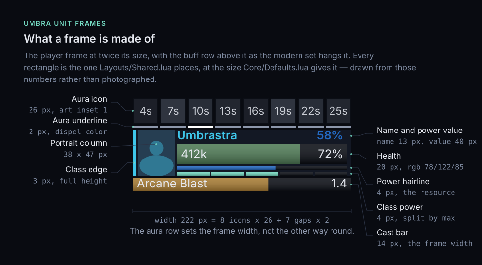
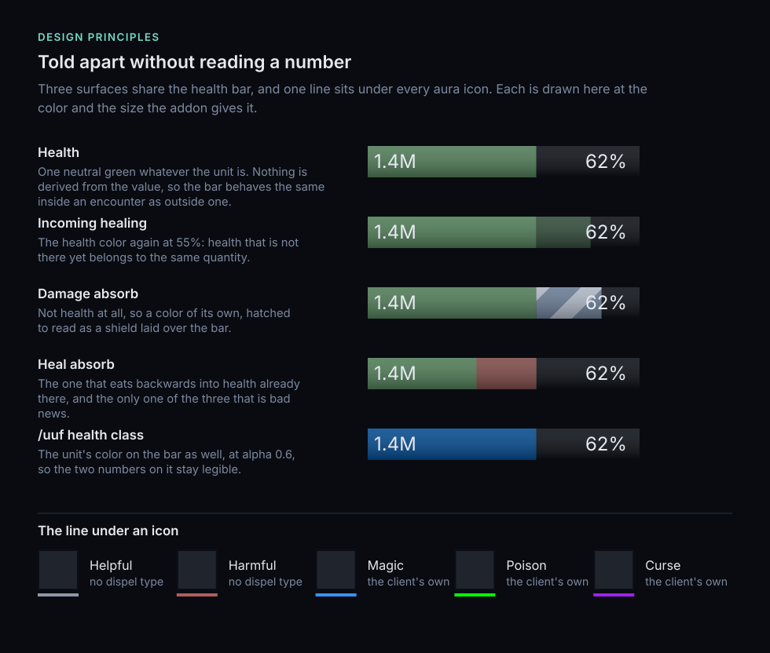
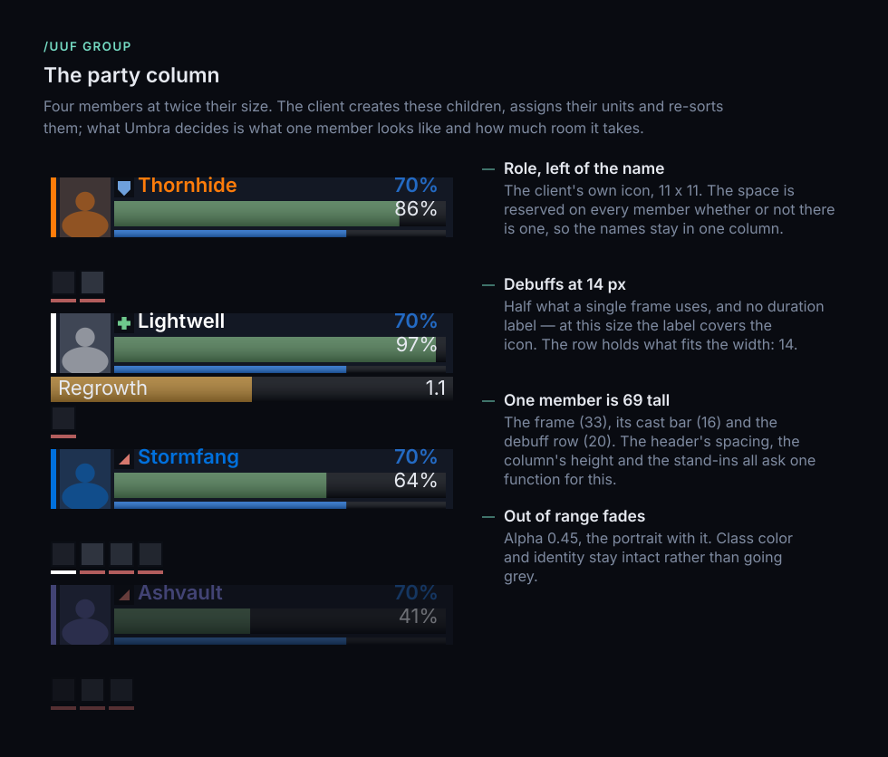
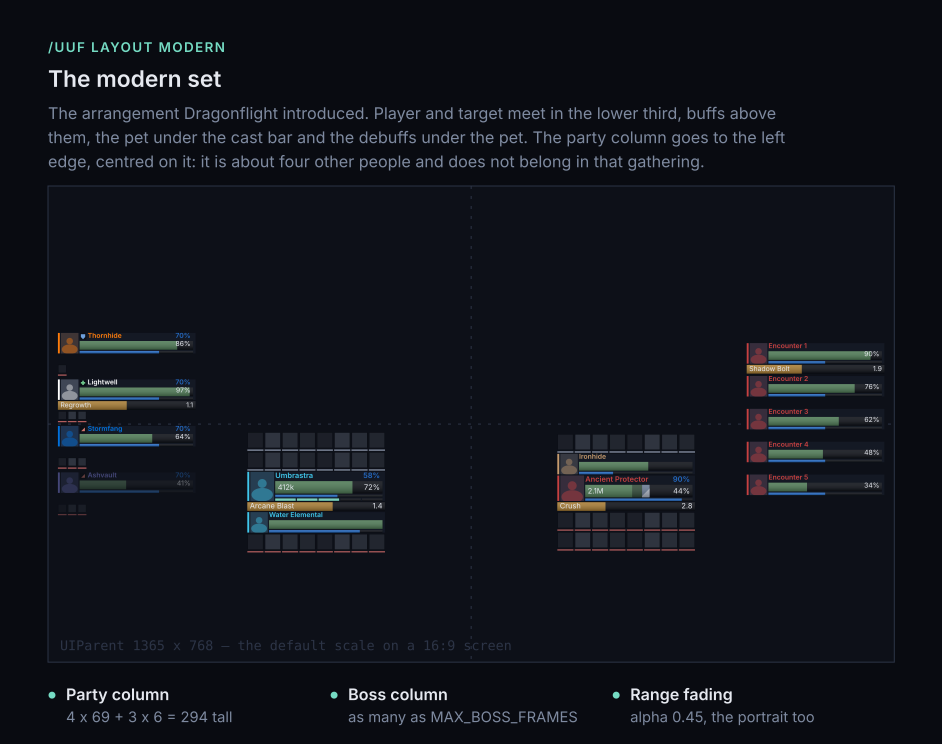
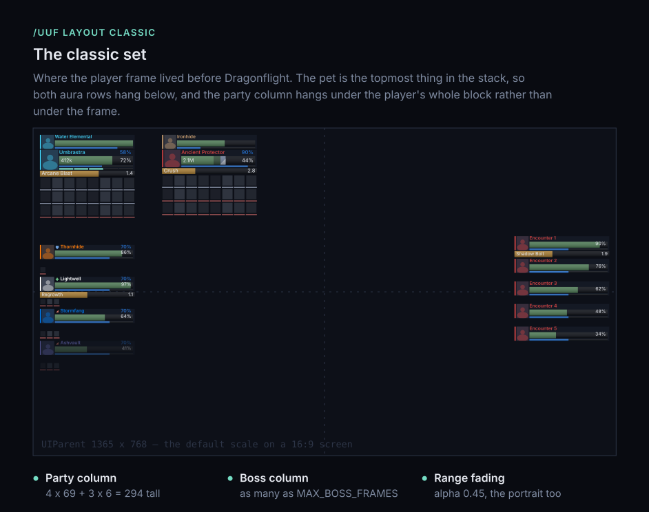
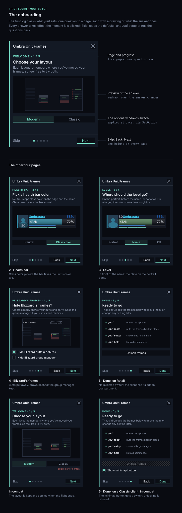
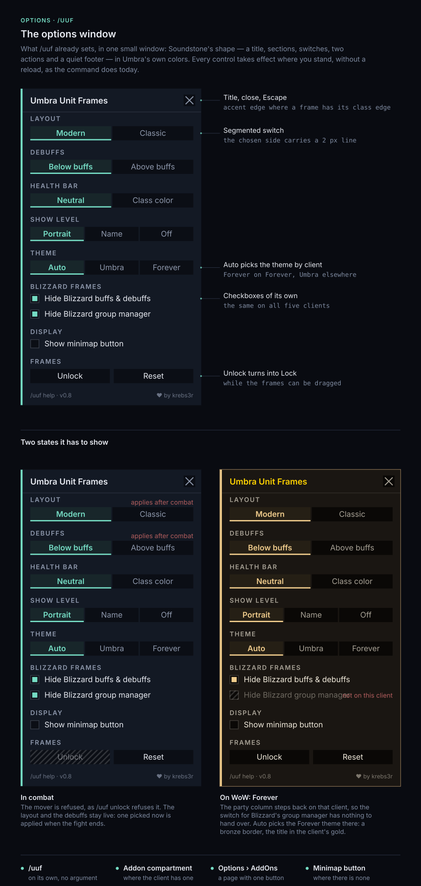
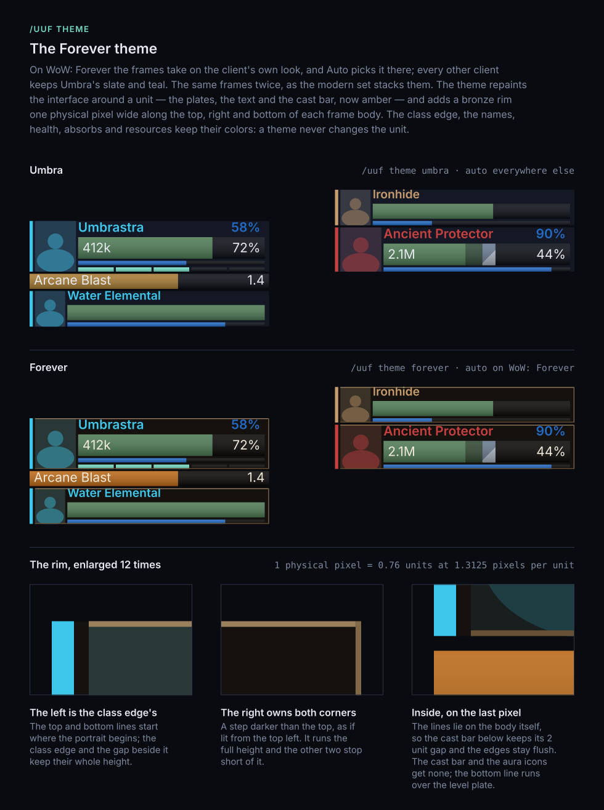
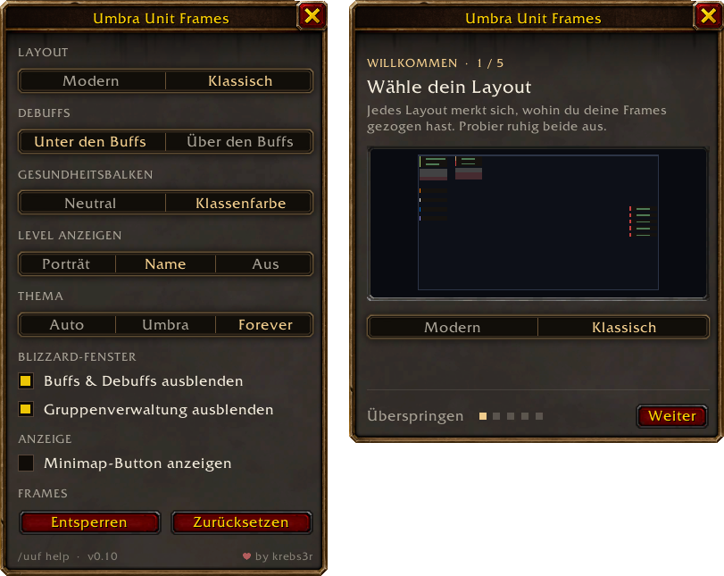

# Umbra Unit Frames

**Your game. Front and center.**

Compact, readable unit frames for **World of Warcraft Retail**, **WoW: Forever** and the **Classic clients**: Mists of Pandaria, the Anniversary realms and Classic Era. Your class color sits on the edge of the frame, your portrait gets a column of its own, and the numbers you actually read stay the biggest thing on screen.

Inspired by ShadowedUnitFrames — the same idea about what a unit frame is for, with a look of its own.

> **Where it stands.** Everything below is built and in use. Every setting is in a small options window, or behind `/uuf` if you would rather type — both do the same. Clique is not supported, and raid frames are deliberately Blizzard's — both are said plainly further down rather than left as something this has not gotten around to.

---

## What a frame is made of

Player, target, pet, boss, party — every frame is built from the same parts, then cut down to what it is for. A class-colored edge. A portrait column. A name. One health bar that owns the frame, and a hairline underneath it for mana, energy or rage.

---

## Six ideas about reading a frame

**Class color at the edge.** A 3-pixel edge and the name carry your class color. The health bar stays a neutral green, so a drop in health reads as a drop in health and nothing else. If you would rather have class color on the bar too, it is one switch away.

**A portrait in its own column.** A narrow rectangular portrait sits left of the name and bars — on the target frame as well. No circular medallions, no glowing rings, nothing sitting behind your numbers.

**Resources as a hairline.** Mana, energy and rage run in a thin line instead of a second big bar. Health stays the thing you see first.

**Auras with an underline.** A slim colored line under each icon instead of a thick border around it. Your own effects and the ones that matter still jump out, and the grid stays calm.

**Shields and incoming heals you can tell apart.** Absorbs are drawn as hatching. Incoming healing is a pale, see-through segment. Neither one can be mistaken for health you already have.

**Range by fading.** Someone out of range fades out, portrait and all. They stay recognizably themselves instead of turning into a gray copy.

> Accent color belongs to the interface. Class color belongs to the unit. The health bar belongs to health.

---

## What you get

| Frame | What it carries |
| :--- | :--- |
| **Player** | Cast bar, class power (combo points, holy power, runes and the rest), power value, level, 16 buffs and 8 debuffs — and in an inn or a city the game's Z's in the portrait's corner |
| **Target** | Cast bar, power value, level in the game's difficulty color, 8 buffs and 16 debuffs — the other way round, because what *you* put on the target is why you are looking at it |
| **Pet** | Same width so it lines up, but short: no cast bar, no aura rows. Its level stands where yours does, and a hunter's pet shows its mood in the color of its edge and portrait — green, yellow when it wants feeding, red when it is unhappy — on WoW: Forever, the Anniversary realms and Classic Era |
| **Target of target** | One question — is it on the tank or on me — and cut the same way |
| **Boss** | As many as the fight has, each keeping its cast bar |
| **Party** | A column with cast bars, power values, levels, a row of debuffs, the role each member signed up as, and range fading — on WoW: Forever since its release; its beta could not build one |
| **Raid** | Not yet, and not next — Blizzard's own do the job, class coloring included, and the group header carries them whenever they are wanted |

There is deliberately **no focus frame**. One was built and taken back out: a frame that is empty most of the time is a frame in the way.

**The level** sits on a small plate across the foot of the portrait, so the name keeps its whole width — or in front of the name, or nowhere, as you prefer. On the target it takes the game's difficulty color, gray to red; an elite carries a `+`, and something too far above you to tell reads `??`. And when a kill would be worth nothing — somebody else tagged it first, or it is too far below you to give experience — the target's health bar turns gray, while the edge and the name keep their color.

The party column is built on the game's own group header, which means the game creates and sorts the members — in combat as well as out of it.

---

## Two layouts, one switch

A layout decides three things at once, because they only make sense together: where the frames sit, which side the aura rows hang on, and whether your pet sits above you or below. Each layout remembers its own dragged positions, so you can set both up and switch freely.

### `modern` — the default

The arrangement Dragonflight introduced. Player and target meet in the lower third, buffs above them, the pet under the cast bar, debuffs under the pet. The party column goes to the left edge.

### `classic` — where the player frame used to live

Player and target in the top left, the pet above them, both aura rows below, and the party column hanging under the whole block.

The boss column is the same in both — right edge, centered. It is not part of the arrangement you chose; it is something the fight brings.

### Debuffs over the buffs

Keep your frames right above the action bars? `/uuf debuffs above`, or the *Debuffs* switch in the options window, draws the debuff row over the buff row in either layout. In `modern` both rows then hang above the frame, the debuffs on top, and under the player only the cast bar and the pet are left; in `classic` the debuffs move next to the frame, over the buffs. Your frames keep their places, and the party column keeps its debuffs under each member.

---

## Settings

**The first login asks.** A small window walks you through the settings, one question to a page and each with a drawing of what the answer does: the layout, the health bar's color, where the level stands, whether Blizzard's own buffs and group manager stay, and finally how to drag the frames into place. Every answer takes effect as you click it, *Skip* keeps the defaults, and `/uuf setup` brings the questions back whenever you like. An update from an earlier version does not ask — you have chosen already.

`/uuf` opens the options window. You also find it in the addon compartment under the minimap on Retail and Forever, on a minimap button on the Classic clients, and under *Options › AddOns* everywhere. **Every setting takes effect where you stand** — no `/reload`. In a fight the mover is refused, as the game requires; a layout or a debuffs placement picked mid-combat is kept and applied when the fight ends.

The window speaks German on a German client and English everywhere else.

It offers nothing the commands do not, and `/uuf help` lists them:

| Command | Values | What it does |
| :--- | :--- | :--- |
| `/uuf layout` | `classic`, `modern` | the whole arrangement |
| `/uuf debuffs` | `below`, `above` | whether the debuff row goes under the buff row or over it |
| `/uuf auras` | `umbra`, `both` | who shows your buffs and debuffs |
| `/uuf health` | `class`, `plain` | what colors the health bars |
| `/uuf group` | `umbra`, `both` | whether the game's group manager stays on the left edge |
| `/uuf level` | `portrait`, `name`, `off` | where the level stands, or whether it does |
| `/uuf theme` | `auto`, `umbra`, `forever` | the frames' colors — `auto` gives WoW: Forever its own look |
| `/uuf unlock` | — | drag the frames — all of them, filled out so you can see what you are placing |
| `/uuf lock` | — | put them back to work |
| `/uuf reset` | — | forget this layout's dragged positions |
| `/uuf setup` | — | the questions of the first login, again |

Type a setting without a value and it tells you what it is on and what the alternatives mean.

Defaults are `modern`, `below`, `both`, `plain`, `both`, `portrait` and `auto` — Blizzard's aura display and group panel stay up until you say otherwise, because that panel carries your raid markers and the way out of a group, and `auto` picks the frames' colors by game version.

There is also `/uuf dev`, a set of read-only checks that change nothing and print what your client is doing. `/uuf dev test` fills every aura slot with stand-ins so you can judge a layout at its fullest, and `/uuf dev check` gives you most of a good bug report in a window you can copy out of.

---

## Installing

Grab it with your addon manager, or unpack the zip into `Interface\AddOns` yourself.

The folder is named **`UmbraUnitFrames`** and the command is `/uuf`. There is an unrelated addon called *Umbra* — the longer name keeps both installable side by side.

One package covers every supported game version; you do not need to pick a build.

---

## Which game versions

| | Retail (Midnight) | WoW: Forever | Mists of Pandaria Classic | Anniversary (Burning Crusade) | Classic Era |
| :--- | :--- | :--- | :--- | :--- | :--- |
| Supported | yes — tested inside an instance; 0.9's changes seen in the open world only | yes — frames, auras, portraits and the party column seen working, not yet inside an instance | yes — frames, auras and portraits seen working; the party column not yet in a real party | yes — frames, auras and portraits seen working | yes — frames, auras and portraits seen working |

All five run on one codebase. **The Classic clients** call themselves Classic but carry almost everything Umbra and oUF ask of them; each was checked against Blizzard's own interface code for its build before it was tried in game. The aura rows are the main exception — those clients lack the widget Retail builds them from, so Umbra draws the same buttons itself there. Right-click to cancel a buff works out of combat only on them.

What the class power row does not know yet stays empty: Eclipse, Shadow Orbs, Burning Embers and Demonic Fury on Mists, where Chi shows for Windwalker only. Burning Crusade and Classic Era show combo points and nothing else, and Burning Crusade has no boss column to fill.

Forever launched on **4 November 2026**, and Umbra loads and draws on its release client as it did on the beta. Forever tells addons it is a game of its own rather than Retail, which Umbra has known since 0.8.

**On Forever, the frames take on Forever's own look.** Near-black plates, a one-pixel line of bronze along the top, right and bottom of each frame, and an amber cast bar — the colors were sampled from the game's own tooltips and zone plaques. The options window and the first-login window wear the game's own window frame, as its own windows do. Your class color keeps the left edge, and nothing that belongs to a unit changes: health, class color, resources and the colored line under a debuff stay exactly as they are everywhere else. That is `/uuf theme auto`, the default, so after the update your frames on Forever look different. `/uuf theme umbra` brings back the slate and teal, `/uuf theme forever` brings the bronze to any other game version, and the switch in the options window does the same, at once and with no `/reload`. A switch in combat should work too, since only colors change, but has not been tried in one yet.

**The party column works on Forever's release client.** On the beta it could not be built: that client's own group-header code could not finish the buttons it created, for Umbra or for any other addon, so Umbra stood its column down there and handed Blizzard's group panel back. The release client finishes them, and in a real group the column drew the party — nothing in Umbra had to change. Umbra still checks within two seconds of the column first appearing, and `/uuf dev header` answers where any given client stands. **Retail was never affected.**

**A word on Secret Values.** Since patch 12.0 the game hides exact health and power numbers inside encounters, Mythic+ and PvP — addons may display them but not read them. Umbra's design happens to suit that well: a neutral health bar with class color on the edge never needed to work out a color from your health, so your frames look and behave the same inside a boss fight as outside one. What you will notice is that health reads as a percentage while the fight hides the number.

---

## About the pictures above

These sheets are **drawings, not screenshots.** They are generated from the same measurements the addon lays the frames out with, so the sizes, spacing and colors you see are the real ones. What they cannot show you is anything the game decides at the moment of play: the fonts are your client's, the spell art in an icon is the real spell's, and a portrait is a live 3D model rather than the silhouette drawn here.

---

## Credits

ShadowedUnitFrames is the visual inspiration behind Umbra, and thank you to the authors and the community who carried that idea through so many versions of WoW.

Umbra is an **independent addon**, not an official successor to ShadowedUnitFrames, and is not affiliated with Blizzard Entertainment. The inspiration is visual only — none of ShadowedUnitFrames' code is used here.

Built on [oUF](https://github.com/oUF-wow/oUF).

## License and source

Umbra's own code is MIT licensed, and the source lives on [GitHub](https://github.com/krebs3r/umbra-unit-frames). If this project ever goes quiet, someone else can pick it up — which is precisely what ShadowedUnitFrames could not offer.

Umbra is free and stays free. If it earns a place in your interface and you would like to support the work anyway, [GitHub Sponsors](https://github.com/sponsors/krebs3r) is the one channel set up for it.

Bug reports and feedback are welcome, and the most useful ones say **which piece of information got harder to read**.

---

**UMBRA UNIT FRAMES** — *Less clutter. More clarity. Your game. Front and center.*
